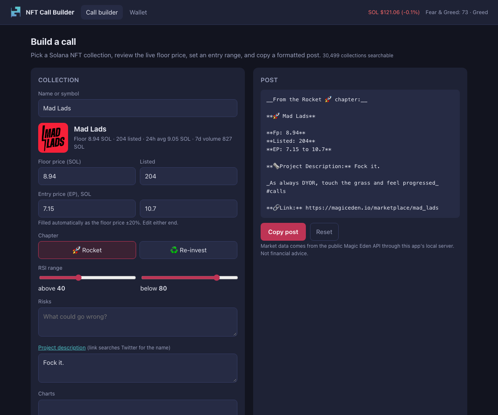

# NFT Call Builder

A small web tool for writing a **Solana NFT "call"**: a short, consistently formatted post about a collection, with its live floor price, an entry range, an RSI note, risks and a link. Search a collection, review the market numbers, fill in your view, and copy the finished post for a chat channel.



*Screenshot taken from the running app; the market numbers are a snapshot.*

## What it does

- **Call builder:** type a collection name or symbol (autocomplete over about 30,000 Magic Eden collections), and the floor price, number listed, 24-hour average, 7-day volume, description, image and marketplace link fill in from live data.
- **Entry range (EP):** suggested automatically as the floor price ±20%. Edit either end.
- **RSI range:** two sliders; the upper bound sets a verdict (below 25 "Perfect Entry", 25 to 49 "Good", 50 to 74 "Medium", 75 and above "Bad") that is written into the Charts field once you move a slider.
- **Chapter:** Rocket 🚀 or Re-invest ♻️, which changes the heading of the post.
- **Post preview and copy:** the post updates as you type and copies to the clipboard. Empty sections are left out. An optional footer, remembered in your browser, is added at the end.
- **Wallet page:** the NFTs held by any public Solana address, with paging.
- **Ticker:** SOL price and the Crypto Fear & Greed index.
- `?collection=<symbol>` and `?address=<wallet>` in the URL open a collection or a wallet directly.

The post is written in the Markdown flavour of the Telegram channel this was made for (`**bold**`, `__underline__`, `_italic_`). Other apps render it differently.

## Run it

Needs Node.js 20 or newer. There are no dependencies to install.

```bash
node server.js            # http://127.0.0.1:3000   (PORT=3111 node server.js to change)
npm test                  # unit and server tests
```

On the first start the server downloads the collection list in the background (about 30,000 collections, roughly 45 seconds, paced to respect the API's rate limit) and keeps it in `.cache/` for 24 hours. The page shows the progress.

## How it works

```
browser  ->  server.js (static files + allow-listed proxy)  ->  Magic Eden, Jupiter, CoinGecko, alternative.me
```

Browsers cannot call the Magic Eden API directly because it sends no CORS headers; the 2023 version worked around this with a public CORS relay. This version instead runs a small local server that serves the pages and proxies a fixed set of read-only endpoints:

| Route | What it does |
|---|---|
| `GET /api/collections?q=` | search the cached collection list |
| `GET /api/collection/:symbol` | metadata from the list plus live stats, converted to SOL |
| `GET /api/wallet/:address` | NFTs for an address, paged |
| `GET /api/ticker` | SOL price (Jupiter, falling back to CoinGecko) and Fear & Greed |
| `GET /api/status` | how far the collection list has loaded |

```
server.js            the server (no dependencies)
public/index.html    call builder
public/wallet.html   wallet viewer
public/js/lib/format.js   pure logic: formatting, entry range, RSI text, the post itself
public/js/*.js       browser code: UI wiring and API client
test/                32 tests
```

Design notes:

- The server binds to `127.0.0.1` and only forwards to fixed hosts with validated parameters (collection symbols and base58 wallet addresses); it is not an open proxy. It has no authentication or rate limiting, so **do not expose it to the internet**.
- Responses from the market APIs are untrusted: the UI builds the page with `textContent` instead of `innerHTML`, only accepts `http(s)` URLs for images, and the pages are served with a strict Content-Security-Policy.
- Market stats are cached for 30 seconds and the ticker for a minute, so repeated clicks do not hit the rate limit.

## History

The first version of this project was a static prototype I wrote in 2023 (May to August, by file dates): a few HTML pages with jQuery that called the Magic Eden and Jupiter APIs straight from the browser. It had a collection browser, a wallet page and the call form. In October 2026 it was checked against the live APIs and most of it no longer worked, so it was rewritten:

| 2023 version | Now |
|---|---|
| Browser called Magic Eden directly through a public CORS relay | Local proxy server |
| `/volumes` endpoint for 24h volume | gone (the endpoint returns 404), so the ticker shows SOL price and Fear & Greed instead |
| `price.jup.ag/v1` for the SOL price | no longer reachable; uses Jupiter's current price API with a CoinGecko fallback |
| "Top" and "Hot" collection pages | removed: `popular_collections` returns an empty list for every time range |
| Wallet address and a Telegram invite link written into the code | wallet address is an input, and the footer is a setting |
| Entry range of floor ± 2 SOL (nonsense for a 0.3 SOL collection) | floor ± 20% |
| Loaded the whole collection list in the browser, with a 7-second delay hack | loaded once by the server and cached |
| Page built from API text with `innerHTML` | `textContent` only, plus a Content-Security-Policy |
| No tests | 32 tests |

The previous prototype is also in this account as the archived `Calling-App` repository.

## Limitations

- **The collection list is incomplete.** It has about 30,500 collections but leaves out some well-known ones (for example `degods`, `okay_bears` and `solana_monkey_business`). For those, type the exact symbol and press Enter: floor price, listed count and volume load, but the image and description do not. The single-collection metadata endpoint is rate-limited for unauthenticated clients, so there is no way around this without an API key.
- **It depends on third-party APIs** that can change or limit access again; the Magic Eden API allows about 180 requests a minute.
- **The browser UI is not covered by automated tests.** The formatting logic and the server are (32 tests, no network needed), and the pages were checked in headless Chrome against the live APIs (the screenshot above), not by automated UI tests.
- Not tested on a phone, though the layout is responsive.
- Not financial advice. The RSI "verdicts" are a simple rule from the original tool, not analysis.

## AI assistance

The 2023 prototype was written by me. This rewrite, with its server and tests, was developed with AI assistance (Claude Code). I specified the behaviour and reviewed the result.

## License

MIT
